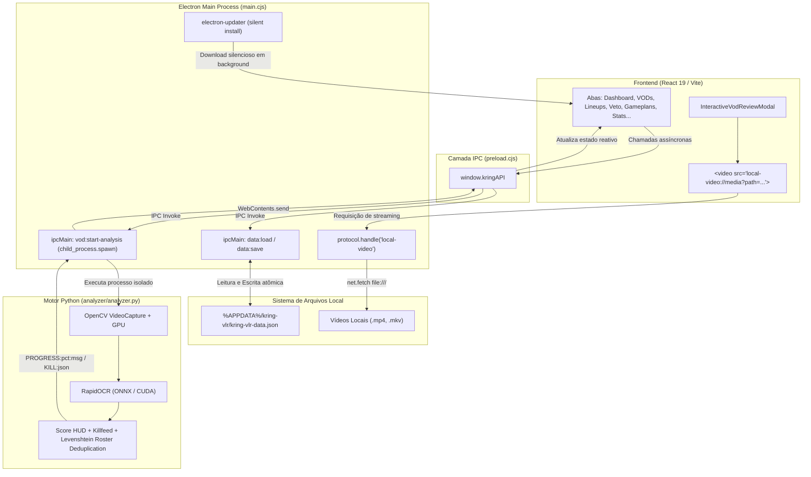
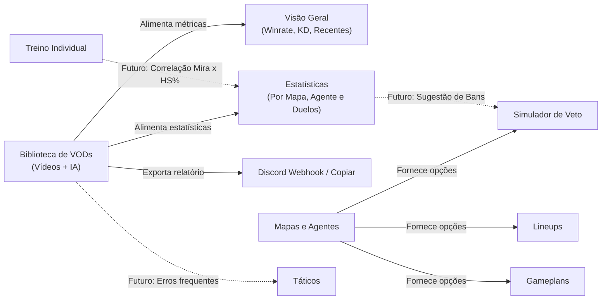

# Kring VLR — Arquitetura do Sistema, Memória Técnica e Roadmap

> **Documento de Memória Persistente do Projeto**  
> *Criado para manter o histórico técnico completo, fluxo de dados entre abas, decisões de arquitetura e próximos passos para qualquer sessão de desenvolvimento.*

---

## 1. Visão Geral do Projeto

O **Kring VLR** é uma aplicação desktop desenvolvida sob medida para jogadores e times competitivos de Valorant, servindo como uma central completa de alta performance para:
1. **Revisão Inteligente de VODs com IA Local**: Reconhecimento automático de placar, rodadas, abates (killfeed), first kills, headshots e estatísticas de jogadores sem envio de vídeos para a nuvem.
2. **Reprodutor de Review Integrado**: Player de vídeo acelerado por hardware sincronizado lance a lance com a timeline do treino.
3. **Gestão Tática & Gameplans**: Criação de estratégias de ataque/defesa, setups e vetos de mapas.
4. **Catálogo de Lineups**: Repositório visual categorizado por agente, mapa, bomb e habilidade.
5. **Estatísticas & Treino Individual**: Métricas consolidadas de desempenho e registro de rotinas de mira/aquecimento.

---

## 2. Stack Tecnológica

| Camada | Tecnologia | Papel |
| :--- | :--- | :--- |
| **Shell Desktop** | **Electron 34+** | Gerenciamento de janelas, ciclo de vida, auto-updater e chamadas ao SO |
| **Frontend UI** | **React 19 + Vite 7** | Interface de alta reatividade, tema Dark/Light, Vanilla CSS |
| **Comunicação Segura** | **Preload IPC + ContextBridge** | Exposição segura da API `window.kringAPI` sem expor `nodeIntegration` |
| **Motor de Visão / IA** | **Python 3.12 + OpenCV + RapidOCR** | Processamento computacional local de vídeo com suporte a GPU/DirectShow/CUDA |
| **Armazenamento** | **JSON Local Atômico** | Armazenado em `%APPDATA%\kring-vlr\kring-vlr-data.json` |
| **Distribuição / Update** | **electron-builder + electron-updater** | Atualizações automáticas e silenciosas via GitHub Releases |

---

## 3. Mapa de Comunicação e Arquitetura do Sistema



---

## 4. Onde os Dados Residem e Estrutura do Schema

### Localização do Arquivo de Dados:
* Caminho: `C:\Users\<Usuario>\AppData\Roaming\kring-vlr\kring-vlr-data.json`
* Gerenciado via `app.getPath('userData')` em [electron/main.cjs](file:///c:/AnaliseValorant/electron/main.cjs).

### Estrutura do Schema Principal (Versão 3):
```json
{
  "schemaVersion": 3,
  "vods": [
    {
      "id": "vod-uuid",
      "title": "vs ARRANCADREAM",
      "date": "2026-10-24",
      "map": "Abyss",
      "result": "Vitória",
      "roundsWon": 17,
      "roundsLost": 7,
      "kills": 26,
      "deaths": 10,
      "assists": 5,
      "openingDuelsWon": 3,
      "openingDuelsLost": 1,
      "localVideoPath": "C:\\AnaliseValorant\\vs ARRANCADREAM.mp4",
      "notes": "Treino tático com foco em controle de meio",
      "analysisData": {
        "duration": "43:30",
        "rounds_count": 24,
        "final_score": { "friendly": 17, "enemy": 7 },
        "rounds": [
          {
            "round_number": 1,
            "start_time": "02:15",
            "end_time": "03:45",
            "winner": "friendly",
            "score_after": "1-0",
            "kills": [
              {
                "time": "02:45",
                "timestamp_sec": 165.2,
                "killer": "lowz77",
                "killer_agent": "Chamber",
                "killer_team": "friendly",
                "victim": "tokky",
                "victim_agent": "Chamber",
                "victim_team": "enemy",
                "headshot": true,
                "first_kill": true
              }
            ]
          }
        ],
        "all_kills": [ /* lista cronológica de todos os abates */ ],
        "players_stats": {
          "lowz77": {
            "agent": "Chamber",
            "team": "friendly",
            "kills": 26,
            "deaths": 10,
            "headshots": 1,
            "first_kills": 3,
            "first_deaths": 1,
            "headshot_rate": 3.8,
            "kd_ratio": 2.6
          }
        }
      }
    }
  ],
  "lineups": [
    {
      "id": "lineup-uuid",
      "agent": "Sova",
      "map": "Ascent",
      "side": "Ataque",
      "site": "A",
      "ability": "Flecha Rastreadora",
      "title": "Flecha Céu A da Base",
      "description": "Alinhar no poste da base, 1 barra de carga.",
      "link": "https://..."
    }
  ],
  "tactics": [
    {
      "id": "tac-uuid",
      "title": "Split A Padrão",
      "map": "Ascent",
      "side": "Ataque",
      "notes": "Smokes no Céu e Janela, bang do Omen no gerador.",
      "steps": ["Setup de drones", "Execução 1:15"]
    }
  ],
  "gameplans": [
    {
      "id": "gp-uuid",
      "title": "Gameplan Abyss VCT",
      "map": "Abyss",
      "comp": ["Chamber", "Fade", "Omen", "Sage", "Waylay"],
      "attackingPlan": "Controle rápido do meio e pressão A",
      "defendingPlan": "Setup retake B com Chamber âncora"
    }
  ],
  "training": [
    {
      "id": "tr-uuid",
      "date": "2026-10-24",
      "routine": "Aim Lab - Microflex",
      "score": 98450,
      "notes": "Boa consistência no clique único"
    }
  ],
  "maps": [ /* catálogo de mapas ativos */ ],
  "agents": [ /* catálogo de agentes com papéis e fotos */ ]
}
```

---

## 5. Como as Abas Conversam Entre Si (Fluxo Integrado)



1. **VODs ➔ Visão Geral (Dashboard):**
   * Toda partida registrada em `vods` recalcula instantaneamente os cards de resumo: Total de Jogos, Taxa de Vitória (`winrate`), K/D médio consolidado, vitórias recentes e melhor mapa.
2. **VODs ➔ Estatísticas:**
   * A aba de estatísticas agrupa as partidas por agente e por mapa.
   * Calcula performance de First Kills e First Deaths a partir das partidas analisadas.
3. **Catálogos ➔ Lineups, Veto e Gameplans:**
   * Lista central de mapas (`maps`) e agentes (`agents`) alimenta os selects de filtros de lineups e composições táticas.
4. **Review de Treino (Modal) ➔ Análise Lance a Lance:**
   * Abertura do modal de review sincroniza o arquivo de vídeo do disco com os eventos (`all_kills`) e rodadas (`rounds`).
   * Clicar em qualquer evento da timeline salta o vídeo instantaneamente para `-4 segundos` antes do abate para contexto de mira e posicionamento.
   * Botão "Copiar p/ Discord" gera texto pronto com placar, rodadas e destaques para colar em canais de treino.

---

## 6. Detalhes Cruciais de Implementação e Correções Recentes

### A. Protocolo de Vídeo Local (`local-video://`)
* **Problema Resolvido:** O Chromium tratava `local-video://C:/...` encarando `C:` como host e engolindo os dois pontos (`:`), tornando o caminho inválido no Windows.
* **Implementação Vigente:**
  * No [electron/preload.cjs](file:///c:/AnaliseValorant/electron/preload.cjs):
    `toLocalVideoUrl: (filePath) => 'local-video://media?path=' + encodeURIComponent(filePath)`
  * No [electron/main.cjs](file:///c:/AnaliseValorant/electron/main.cjs):
    Lê `new URL(request.url).searchParams.get('path')` e passa para `net.fetch(pathToFileURL(targetPath).toString())`.
  * **Resultado:** Streaming acelerado por GPU com busca precisa (seek), controle de velocidade (0.5x a 1.5x) e zero falhas de rota.

### B. Otimização do Motor de Análise (`analyzer/analyzer.py`)
* **Aceleração do Killfeed:** 
  * Caching por diferença de pixels (`cv2.absdiff(kf_gray, last_kf_gray) > 3.5`).
  * Threshold do banner de kill elevado de 250 para 750 pixels, eliminando OCR em texturas claras de mapa.
  * Chamadas de OCR reduzidas de ~2.700 para ~150-200 em uma partida de 45 minutos.
* **Prevenção de Ruído:**
  * Nicknames puramente numéricos (`12`, `100`, `150`) ou termos de HUD (`FENSE`, `Aliado`, `Inimigo`, `25/25`) são descartados pelo `resolve_player` exigindo caracteres alfabéticos válidos.

### C. Redimensionamento e Placar Responsivo no Review
* **Botão Maximizar / Restaurar:** Altera a classe da modal para `.review-modal-card.maximized` (ocupando `99vw × 97vh`).
* **Grid Dinâmico:** Ao entrar na aba "Placar do Treino", a proporção do modal muda para `.scoreboard-active` (`1fr 1.45fr`), permitindo que todas as 9 colunas fiquem visíveis sem cortes.
* **Clustering Fuzzy (Levenshtein) no Frontend:** Agrupa nomes com pequenas variações de OCR (ex: `low277` ➔ `lowz77`, `lokky` ➔ `tokky`), destacando o MVP com troféu dourado e fornecendo filtros rápidos (`Todos`, `Aliados`, `Inimigos`).

### D. Auto-Updater 100% Silencioso
* Configurado em [package.json](file:///c:/AnaliseValorant/package.json): `"oneClick": true`, `"perMachine": false`, `"allowElevation": false`.
* No [electron/main.cjs](file:///c:/AnaliseValorant/electron/main.cjs): `autoUpdater.quitAndInstall(true, true)`.
* Atualiza a aplicação sem reabrir instaladores interativos do NSIS.

---

## 7. Estado Atual das Abas (Status do Projeto)

| Aba | Status | Funcionalidades Ativas | O que falta / Pode evoluir |
| :--- | :---: | :--- | :--- |
| **Visão Geral** | 🟢 100% | Métricas de winrate, K/D, partidas recentes, filtros de data e mapas | Gráficos de tendência de mira/desempenho |
| **Simulador de Veto** | 🟢 100% | Sistema Pick & Ban competitivo BO1/BO3/BO5 com sorteio e coin toss | Sugestão automática de Ban baseada no histórico de derrotas |
| **Biblioteca de VODs** | 🟢 100% | Cadastro manual, upload local, análise por IA, review com player sincronizado | Telestrator (desenho tático sobre o vídeo) |
| **Lineups** | 🟢 100% | Cadastro, filtros por mapa/agente/bomb, links externos e visualização | Suporte a upload de imagem/print direto no app |
| **Gameplans** | 🟢 100% | Montagem de composições, planos de ataque e defesa por mapa | Exportar PDF ou imagem para os jogadores |
| **Mapas e Agentes** | 🟢 100% | Catálogo sincronizado com sementes padrão e papéis de agentes | Atualização automática via API da Riot |
| **Táticos** | 🟢 100% | Criação de setups e táticas passo a passo com marcação de lado | Prancheta tática interativa 2D |
| **Treino Individual** | 🟢 100% | Registro de scores de rotinas diárias (Aim Lab, The Range, DM) | Gráfico de evolução de pontuação |
| **Estatísticas** | 🟢 100% | Tabelas de K/D, abates médios, mapas mais vitoriosos, abertura de rounds | Filtro avançado por período (ex: última semana) |

---

## 8. Roteiro de Próximas Implementações (Roadmap)

### Fase 1: Validação & Interconexão Automática entre Abas
1. **Conexão VODs ➔ Gameplans & Táticos:**
   * Quando uma análise de VOD identificar que o time perdeu muitos rounds em um determinado bomb/setup, sugerir revisão do Gameplan daquele mapa.
2. **Conexão Treino Individual ➔ Estatísticas:**
   * Correlacionar pontuação do Aim Lab / Range com a taxa de Headshot (%) e K/D das partidas jogadas no mesmo dia.
3. **Conexão Histórico de VODs ➔ Simulador de Veto:**
   * Na hora do Veto, exibir badges nos mapas: *"Maior Winrate (80%)"*, *"Recomendado para Ban (3 derrotas seguidas)"*.

### Fase 2: Telestrator (Desenho sobre o Vídeo de Review)
* Adicionar camada de `<canvas>` transparente sobre o player de vídeo no modal de review.
* Permitir pausar e desenhar setas, círculos e linhas táticas para reuniões com o time.

### Fase 3: Aceleração Máxima do OCR por Hardware
* Configurar flags do OpenCV para detecção de GPU NVIDIA (DirectX 11 / CUDA / NVDEC) na leitura de frames, acelerando vídeos de 45 min para menos de 10-15 minutos.

---

## 9. Comandos Úteis e Operações Rápidas

```bash
# Rodar em modo de desenvolvimento (Vite + Electron com Hot-Reload)
npm.cmd run dev

# Compilar o código do frontend (Vite)
npm.cmd run build

# Gerar executável instalador Windows (dist/kring-vlr Setup x.x.x.exe)
npm.cmd run dist:win

# Caminho dos dados salvos no PC do usuário:
explorer "$env:APPDATA\kring-vlr"
```
