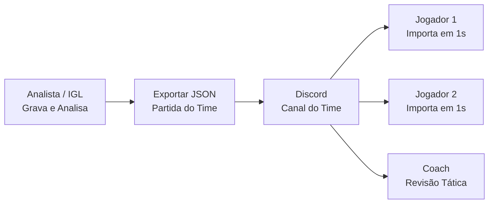

<div align="center">

# Kring VLR

### Painel Inteligente de Scrims, Análise de VODs por Visão Computacional e Caderno Tático para Valorant

[](https://github.com/gabrielphilipus/kring-vlr)
[](https://github.com/gabrielphilipus/kring-vlr/releases)
[](https://www.electronjs.org/)
[](https://react.dev/)
[](https://www.python.org/)
[](https://opencv.org/)
[](#privacidade-e-seguranca-total)

<p align="center">
  <b>Kring VLR</b> é um ecossistema desktop completo desenvolvido para times amadores, semiprofissionais, analistas e criadores de conteúdo de Valorant.
  Ele automatiza a extração de dados de vídeos gravados (VODs) via <b>Visão Computacional e OCR</b>, sincroniza abates e rounds em um player interativo, gera relatórios instantâneos para o Discord e permite o compartilhamento fácil de partidas entre companheiros de equipe.
</p>

[Baixar Instalador Windows (.exe)](#instalacao-rapida-para-jogadores-e-coaches) • [Principais Funcionalidades](#principais-funcionalidades) • [Como Compartilhar com o Time](#compartilhamento-de-scrims-em-equipe) • [Como Rodar do Código-Fonte](#execucao-para-desenvolvedores)

</div>

---

## Principais Funcionalidades

### 1. Motor de Visão Computacional (AI / OCR)
* **Reconciliação Oficial pelo Scoreboard (100% de Precisão):** Algoritmo de amostragem multi-frame e votação estrita por moda com validação algébrica de integridade ($K \le D$, $\sum \text{First Bloods} \in \{R, R-1\}$). Garante que abates, mortes, assistências, first bloods, plants e defuses batam exatamente com o placar oficial do jogo.
* **Killfeed Inteligente por Slots:** Rastreamento frame a frame de todas as linhas de abate com identificação por slot físico, rejeição de releituras, deduplicação temporal adaptativa de 5,5s e detecção de headshots ancorada no ícone da arma e fronteiras de cores das placas.
* **Detecção Automática de Rodadas:** Delimitação de início e fim de cada round ancorada na *Buy Phase* do HUD com trava temporal mínima ($\ge 35\text{ s}$), eliminando transições fantasmas e rounds espúrios.
* **Ressurreições Suportadas:** Detecção de eventos de ressurreição (Sage/Clove) com expansão dinâmica da capacidade de mortes do time no round.

### 2. Player Interativo de Review de Treino
* Player de vídeo local integrado com busca assíncrona ultrafluida.
* **Salto Instantâneo para Abates:** Clique em qualquer abate na linha do tempo para saltar o vídeo direto para a ação (com compensação configurável de `-3s` para rever a tomada de decisão antes do tiro).
* Filtros por round, equipe (aliados/inimigos), abates de abertura e velocidade de reprodução customizada (0.5x a 2.0x).
* Aba de Placar Oficial detalhado com K/D/A, taxas de headshot, abates de abertura, plantas e defuses de todos os 10 jogadores.

### 3. Compartilhamento de Scrims em Equipe
* **Exportação em Arquivo Único (`.json` / `kring-match-v1`):** O analista ou jogador grava e processa a partida uma única vez e clica em **Exportar Partida**.
* **Importação Instantânea:** Qualquer jogador ou coach do time clica em **Importar Partida** e carrega todos os 24 rounds, estatísticas e timeline em 1 segundo, **sem precisar ter o vídeo baixado e sem reprocessar nada**.

### 4. Dashboard Analítico & Relatórios para Discord
* Estatísticas completas: Winrate, K/D, ADR, taxas de abertura (*First Kills* vs *First Deaths*), desempenho por mapa, agente e lado (Atacante vs Defensor).
* **Exportação p/ Discord em 1 Clique:** Formata automaticamente todo o resumo da scrim (placar, destaques, first bloods, elenco) pronto para colar no canal do time.

### 5. Caderno Tático, Lineups e Treino Individual
* **Lineups:** Catálogo de pixels e execuções com instruções, fotos e suporte a colagem direta da área de transferência (`Ctrl + V`).
* **Gameplans & Táticas:** Registro de táticas padrão, rounds econômicos, pistol rounds e execuções pré-definidas.
* **Rotinas de Treino:** Checklist semanal de mira, deathmatch e treinos táticos com histórico de progresso.

---

## Instalação Rápida (Para Jogadores e Coaches)

Você **NÃO** precisa ter Python, Node.js nem ferramentas de compilação instaladas.

1. Acesse a aba de [**Releases no GitHub**](https://github.com/gabrielphilipus/kring-vlr/releases).
2. Baixe o instalador oficial: `Kring-VLR-Setup-1.1.3.exe`.
3. Execute o instalador. Ele configurará o aplicativo com atalhos na Área de Trabalho e Menu Iniciar, com todos os recursos e motores de visão embutidos. As atualizações futuras são gerenciadas automaticamente pelo próprio programa.

---

## Compartilhamento de Scrims em Equipe



1. **Para Exportar:** No card de qualquer partida analisada na biblioteca ou no player de Review, clique em **Exportar Partida**. O arquivo `kring-match-<mapa>-<data>.json` será baixado.
2. **Para Importar:** Abra a **Biblioteca de VODs** no Kring VLR, clique no botão **Importar Partida** no topo da página e selecione o arquivo recebido. A partida será imediatamente adicionada à sua biblioteca com todos os dados e métricas calculadas.

---

## Privacidade e Segurança Total

* **100% Local e Offline:** Suas estratégias, lineups, análises e gravações permanecem exclusivamente no seu computador. Nenhum arquivo ou frame de vídeo é enviado para servidores externos.
* **Backups Rotativos Automáticos:** O aplicativo realiza cópias de segurança automáticas com versionamento atômico para garantir que seus dados nunca sejam corrompidos em caso de queda de energia ou desligamento repentino.
* **Exportação Geral de Backup:** Acesse as configurações a qualquer momento para exportar um backup completo de toda a sua biblioteca.

---

## Execução para Desenvolvedores

Caso queira contribuir, auditar ou executar o projeto a partir do código-fonte:

### Pré-requisitos
* **Node.js:** Versão 20+ LTS (recomendado 22.x).
* **Python:** Versão 3.12+ (com pip adicionado ao PATH).
* **Git.**

### Passo a Passo

1. **Clone o repositório:**
   ```powershell
   git clone https://github.com/gabrielphilipus/kring-vlr.git
   cd kring-vlr
   ```

2. **Instale as dependências do Node:**
   `powershell
   npm install
   `

3. **Inicie o ambiente de desenvolvimento:**
   `powershell
   npm run dev
   `

4. **Compilar para produção (Vite):**
   `powershell
   npm run build
   `

### Gerar os Executáveis de Produção (.exe)

O script compila automaticamente o binário standalone do analisador (`analyzer.exe`) antes de gerar o instalador do Electron:

```powershell
# Gerar instalador NSIS completo (.exe instalável):
npm run dist:win

# Gerar versão portátil (.exe que roda sem instalar):
npm run dist:portable
```
Os arquivos finais serão gerados na pasta `release/`.

---

## Arquitetura do Sistema

```
kring-vlr/
├── src/                          # Interface Frontend (React 19 + Vite)
│   ├── components/               # Modais, Lightbox, Componentes Compartilhados
│   ├── domain/                   # Regras de Negócio Puras (Matches, Stats, Discord, Treinos)
│   ├── hooks/                    # Hooks Reativos (useAppData, useKeyPress)
│   ├── pages/                    # Catálogos de Mapas/Agentes, Treinos, VODs
│   └── App.jsx                   # Dashboard Central e Player Interativo de Review
├── electron/                     # Camada Desktop (Electron 39)
│   ├── main.cjs                  # Gerenciamento de Janelas, IPC e Processos do Analisador
│   ├── preload.cjs               # ContextBridge Seguro (kringAPI)
│   └── migrations/               # Migração Segura de Schema de Dados (v3 -> v4)
└── analyzer/                     # Motor de Visão Computacional (Python 3.12 Standalone)
    ├── analyzer.py               # Rastreamento de Killfeed, Scoreboard e Rounds
    ├── interpret.py              # Reconhecimento Algébrico, Votação e Consistência
    ├── templates/                # Gabaritos de Ícones (Headshots / HUD)
    └── build_exe.py              # Compilador Standalone via PyInstaller
```

---

## Licença

Distribuído sob licença de uso pessoal e de equipe. Todos os direitos reservados.
Valorant é uma marca registrada da Riot Games, Inc. Este projeto não é afiliado, endossado ou patrocinado pela Riot Games.
